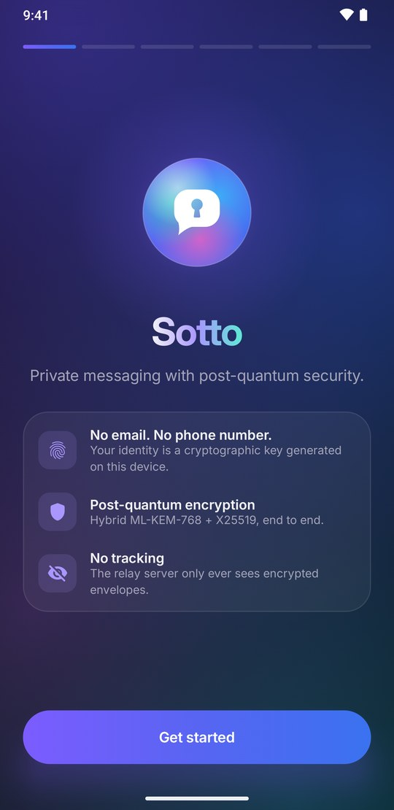
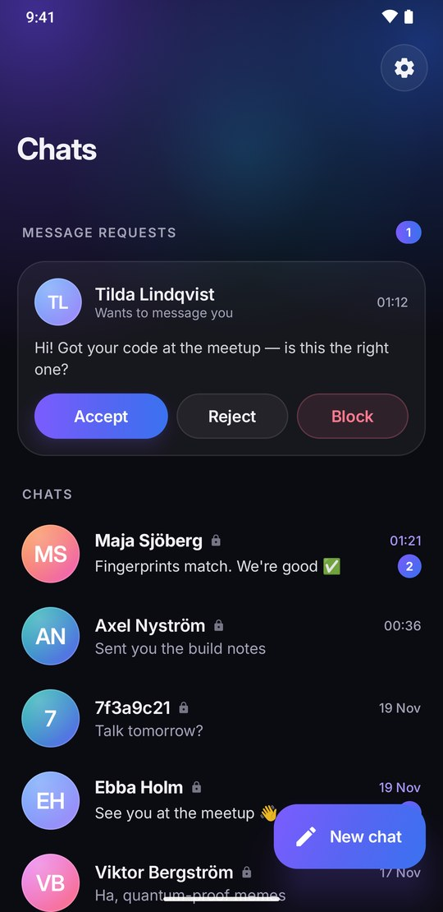
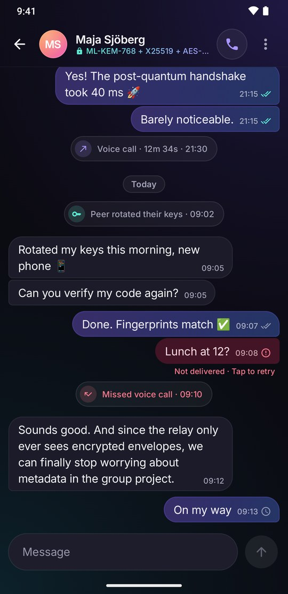
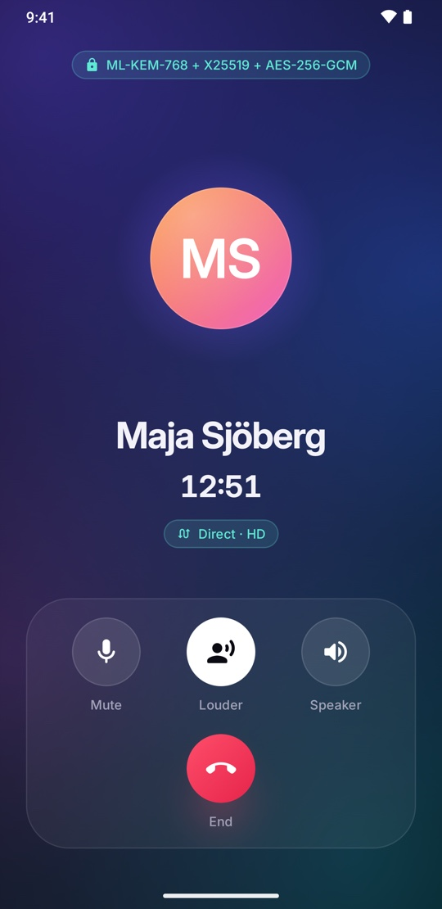
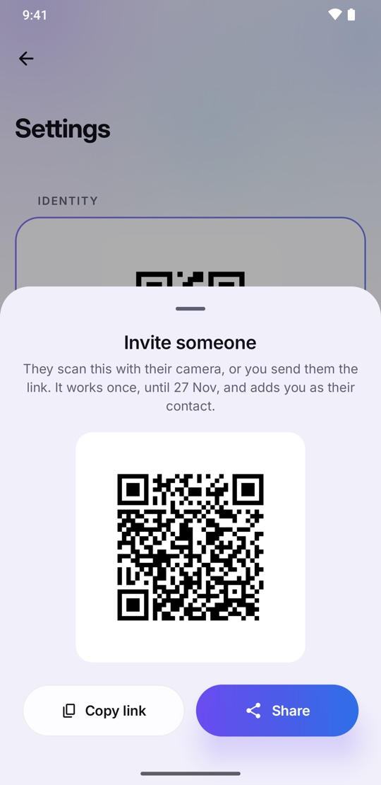
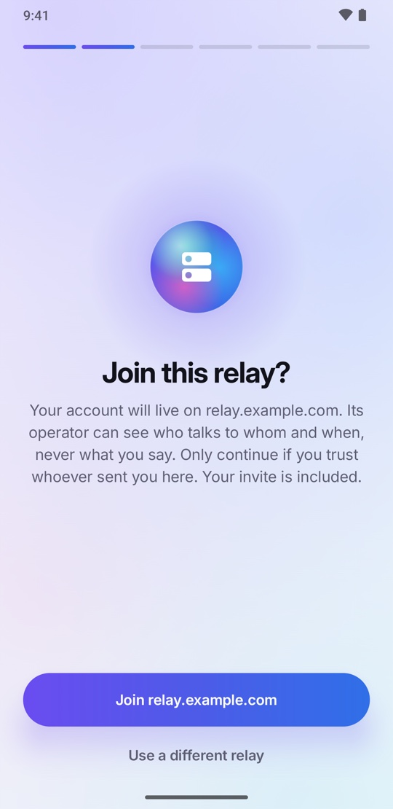
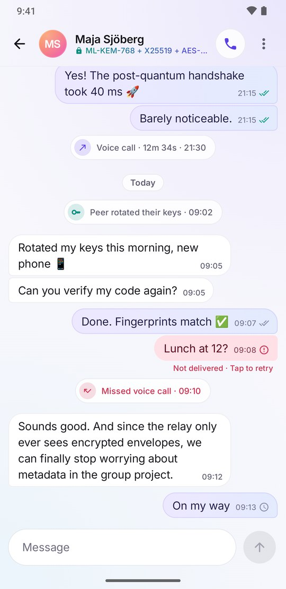
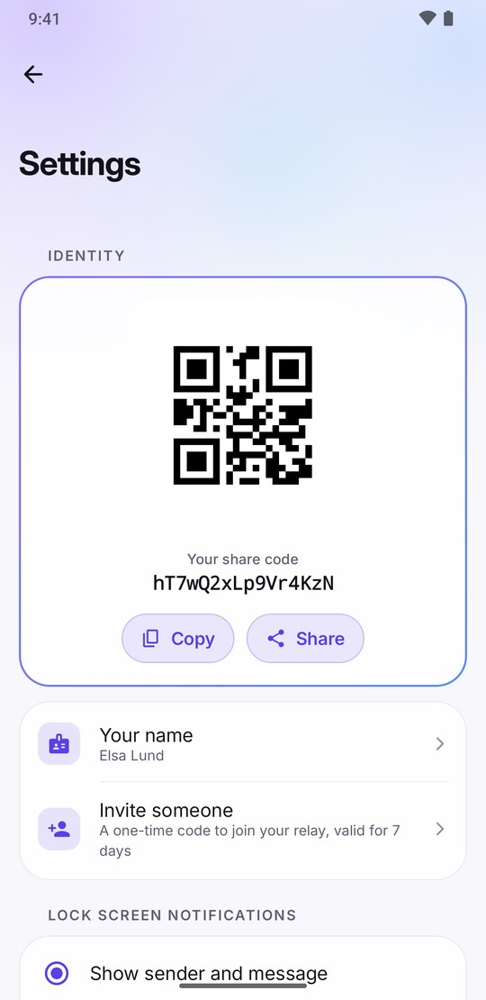

# Sotto

Privacy-first Android messenger for 1:1 chats and voice calls, with hybrid post-quantum end-to-end encryption. The name comes from *sotto voce*, "speaking quietly so others can't overhear". Until 0.6.0 it was called ChatControll.

- **No personal details** — Your identity is a cryptographic keypair generated on your device. No email, phone number, or real name required.
- **Invite only** — You join a relay with a one-time invite from someone already on it. The app comes with no relay of its own, so you can also [run your own](#run-your-own-relay).
- **End-to-end encryption** — Messages are encrypted before leaving your device using a hybrid classical + post-quantum scheme.
- **Voices you can hear** — **Louder** on the call screen lifts the other person's voice without distortion, and is remembered for them; Settings > Calls can also lift every quiet voice by itself. Your microphone goes through the phone's own echo cancellation and noise suppression, or WebRTC's if you choose.
- **Verified in person** — A contact counts as trusted only after you've checked their keys face to face: hold the phones together (NFC) or scan each other's codes. Until then the chat says "Not verified". In a call you can also verify by phone, which counts only as "Verified by phone only".
- **Minimal metadata** — The relay server sees only encrypted envelopes and the minimum routing information needed for delivery.

## Screenshots

| Welcome | Chats | Conversation | In a call |
|:---:|:---:|:---:|:---:|
|  |  |  |  |
| **Invite someone** | **Joining with an invite** | **Conversation** | **Settings** |
|  |  |  |  |

The app follows the system light or dark theme. These are the sample-data previews from the debug build; every name and message in them is made up.

## Joining with an invite

There's no sign-up form. Someone who already uses Sotto invites you:

1. They open **Settings > Invite someone**, which shows the invite as a QR code and as one link, like `https://relay.example.com/invite#c=K7QX-M2PA-9TRB&s=…`: the relay's address with a one-time code. It works once, within 7 days.
2. You tap the link they sent, or scan the QR code with your camera. Without Sotto, the relay's page links to this repository to get the app, and then opens the invite in the app. With Sotto installed, the link opens the app directly.
3. Setup shows which relay the invite is for and asks before joining it. Pasting the link (or the whole message) into setup works too. The link holds both the relay and the code, so there's nothing to type separately.

The person who invited you becomes your first contact. Each member can have 5 invites open at a time and create 10 a day. The code sits after the link's `#`, which browsers never send, so it doesn't reach the relay's web server or its logs.

## Tech stack

- **App:** Kotlin, Jetpack Compose + Material 3 with a custom design system, Clean Architecture + MVVM, Hilt, WorkManager
- **Storage:** Room + SQLCipher (AES-256 encrypted database)
- **Crypto:** hybrid X25519 + ML-KEM-768 key establishment, Double Ratchet, AES-256-GCM, Ed25519 + ML-DSA-65 signatures
- **Calls:** WebRTC voice calls with frame-level media encryption (FrameCryptor). Between contacts who both have direct calls on (the default), audio goes straight between the phones, and each sees the other's IP address. Otherwise it goes through the relay's own TURN server, and neither phone learns the other's address. That covers turning direct calls off on either phone (Settings > Privacy), apps older than 0.5.8, and anyone who isn't a contact
- **Network:** Ktor client and WebSocket to a Python FastAPI relay in `server/`. FCM push is only a wake-up signal, addressed to the app's Firebase installation ID; it carries no sender and never any message content.

## Build & run

You need Android Studio Meerkat (2024.3.1) or later (the project uses Android Gradle Plugin 8.9), JDK 17, Android SDK 35, and a device or emulator running Android 8.0 (API 26) or later.

1. Clone the repository:
   ```bash
   git clone https://github.com/gergelyvagujhelyi/Sotto.git
   cd Sotto
   ```

2. **Add a Firebase config.** The build applies the `google-services` plugin, which needs `app/google-services.json`. That file is gitignored, so bring your own: create a Firebase project at https://console.firebase.google.com, add an Android app with the package name `com.vagujhelyigergely.sotto`, and put its `google-services.json` in `app/`. CI writes the file from the `GOOGLE_SERVICES_JSON` secret (base64-encoded). To build without Firebase, see [Without a server or Firebase](#without-a-server-or-firebase).

3. **Name your relay (optional).** The app treats one relay as its owner's: the only one it lets wake it through push (it must hold the Firebase project's key), the one whose invite links open the app directly, and the one whose certificate chain it pins. That address stays out of the repository: put `sotto.ownerRelayHost=relay.example.com` in `local.properties` (gitignored) or `~/.gradle/gradle.properties`. CI reads it from the `OWNER_RELAY_HOST` secret. Without it, the app works with any relay, just without push.

4. Build and install on a connected device, or press Run in Android Studio:
   ```bash
   ./gradlew installDebug
   ```

### Relay server

```bash
cd server
python -m venv .venv
source .venv/bin/activate
pip install -r requirements.txt
cp .env.example .env
python run.py
```

The server runs at http://localhost:8000. In setup, debug builds suggest `http://10.0.2.2:8000`, the Android emulator's alias for the computer's localhost. On a phone connected over USB, run `adb reverse tcp:8000 tcp:8000` and enter `http://localhost:8000` instead. Debug builds allow plain HTTP only to these hosts and `sotto.local`; release builds need HTTPS. The relay's first account needs no invite, and with `INVITE_ONLY=false` in `.env` later test accounts don't either. [server/README.md](server/README.md) covers the server's API, tests and production deployment.

### Without a server or Firebase

- **No server:** switch the binding in `di/NetworkModule.kt` from `KtorApiService` to `MockApiService`. That's an in-process mock, so no backend is needed and all state lives in memory. Setup still asks for a relay; any address will do.
- **No Firebase:** remove the `google-services` plugin line from `app/build.gradle.kts`; then no `google-services.json` is needed. The app still runs, but without push nothing can wake it for new messages or calls while it is closed.

## Run your own relay

The app works with any Sotto relay, so you can run one for your own people:

1. **A server and a domain.** A small Linux machine with Docker will do. Point a domain at it and get a TLS certificate for that domain, for example from Let's Encrypt.
2. **Configure it.** In `server/`, copy `.env.example` to `.env` and set `POSTGRES_PASSWORD`, `TURN_SECRET`, `TLS_CERT_PATH` and `TLS_KEY_PATH`. Set `RELAY_HOSTNAME` to the relay's name, so it refuses connections that don't ask for it, which most scanners don't. Outside Google Cloud, also set `TURN_RELAY_IP` to the server's public IP address and `TURN_INTERNAL_IP` to the address of its network interface (the same one if the server isn't behind NAT).
3. **Start it** with `docker compose up -d --build`. Open TCP ports 80 and 443, and for calls UDP port 3478 and UDP ports 49152–65535.
4. **Join it first.** In the app's setup, type the relay's address, like `relay.example.com`. The first account on a new relay needs no invite. After that, new people join with a member's invite (`INVITE_ONLY=true`, the default); `INVITE_ONLY=false` lets anyone who knows the address join.

**Invite links on your relay** open its invite page, whose button opens the app; only the author's relay is built into the app for Android to open its links straight in Sotto. If you build the app yourself, set your relay's host as `sotto.ownerRelayHost` (see [Build & run](#build--run)) and your app's package and signing fingerprints in `.env` (`APP_LINK_PACKAGE`, `APP_LINK_CERT_FINGERPRINTS`), and its links open your app directly too.

**No push on your relay:** the released app can be woken only through its author's relay, which holds the app's Firebase key. On any other relay, setup turns on the background connection instead (Settings > Connection), so messages and calls still arrive while the app is closed, at some cost in battery. For push, build the app with your own Firebase project and your relay as `sotto.ownerRelayHost`, and give the relay that project's service account key (`FIREBASE_CREDENTIALS`).

## Documentation

- [ARCHITECTURE.md](ARCHITECTURE.md) — architecture decision records
- [SECURITY.md](SECURITY.md) — threat model, security notes and known limitations
- [CHANGELOG.md](CHANGELOG.md) — what each version added, and what's on `develop` but not released yet

## Roadmap

- **Multi-device support** — link multiple devices under one identity, with device-specific ratchet sessions and synchronized message delivery.
- **Automated key rotation schedule** — periodic identity key rotation with an old-key grace period for in-flight messages.
- **Push proxy** — break FCM token linkability by routing wake-up signals through a proxy service.

## License

See [LICENSE](LICENSE). The app bundles the [Inter](https://github.com/rsms/inter) typeface, licensed under the SIL Open Font License 1.1 ([app/src/main/assets/licenses/inter-OFL.txt](app/src/main/assets/licenses/inter-OFL.txt)).
